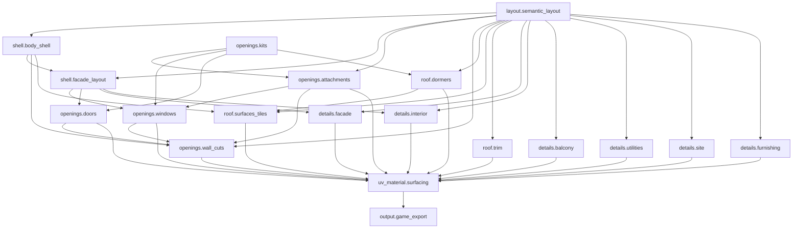

# Module contracts

Generated from the same registry as the HOM builder. Actual paths and connectors are audited in `graph_audit.json`.

| Module | Responsibility | Inputs | Outputs |
| --- | --- | --- | --- |
| layout.semantic_layout | Resolve canonical role, floor, wall and roof guides |  | role_plans, floor_plans, storey_mass, roof_plans |
| shell.body_shell | Construct thick body shell and solid host volumes | plan_floor_plans ← layout.semantic_layout:floor_plans; plan_storey_mass ← layout.semantic_layout:storey_mass | uncut_shell, solid_body |
| shell.facade_layout | Resolve visible stable facade bays and hosted opening points | plan_storey_mass ← layout.semantic_layout:storey_mass; body_shell_solid_body ← shell.body_shell:solid_body; plan_roof_plans ← layout.semantic_layout:roof_plans | visible_bays, opening_points |
| openings.kits | Construct shared window and door geometry and apertures |  | window_geometry, window_aperture, door_geometry, door_aperture |
| openings.attachments | Resolve bay-window replacement hosts and attached opening cutters | plan_role_plans ← layout.semantic_layout:role_plans; plan_roof_plans ← layout.semantic_layout:roof_plans; opening_kits_window_geometry ← openings.kits:window_geometry; opening_kits_window_aperture ← openings.kits:window_aperture | attachment_geometry, bay_cutters, replacement_metadata |
| openings.windows | Place window kits and export their matching cutters | facade_layout_opening_points ← shell.facade_layout:opening_points; opening_kits_window_geometry ← openings.kits:window_geometry; opening_kits_window_aperture ← openings.kits:window_aperture; attachments_replacement_metadata ← openings.attachments:replacement_metadata | window_geometry, window_cutters |
| openings.doors | Place entrances and export matching through-wall cutters | facade_layout_opening_points ← shell.facade_layout:opening_points; opening_kits_door_geometry ← openings.kits:door_geometry; opening_kits_door_aperture ← openings.kits:door_aperture | door_geometry, door_cutters |
| openings.wall_cuts | Union aperture streams and cut the thick wall and gable shell | attachments_bay_cutters ← openings.attachments:bay_cutters; windows_window_cutters ← openings.windows:window_cutters; doors_door_cutters ← openings.doors:door_cutters; body_shell_uncut_shell ← shell.body_shell:uncut_shell; plan_roof_plans ← layout.semantic_layout:roof_plans | walls |
| roof.dormers | Build roof-hosted dormers and their aperture stream | plan_roof_plans ← layout.semantic_layout:roof_plans; opening_kits_window_geometry ← openings.kits:window_geometry; opening_kits_window_aperture ← openings.kits:window_aperture | dormer_geometry, dormer_cutters |
| roof.surfaces_tiles | Construct roof surfaces, thickness, tiles and body/dormer trimming | plan_roof_plans ← layout.semantic_layout:roof_plans; body_shell_solid_body ← shell.body_shell:solid_body; dormers_dormer_cutters ← roof.dormers:dormer_cutters | roof_shell, roof_tiles |
| roof.trim | Construct eave boards, ridges and supported chimneys | plan_roof_plans ← layout.semantic_layout:roof_plans | roof_trim |
| details.facade | Build facade timbers and reference-specific supported modules | facade_layout_visible_bays ← shell.facade_layout:visible_bays; plan_roof_plans ← layout.semantic_layout:roof_plans | structural_timber, facade_details |
| details.interior | Construct floors, stairs and interior structural frames | plan_floor_plans ← layout.semantic_layout:floor_plans; facade_layout_visible_bays ← shell.facade_layout:visible_bays | interior |
| details.balcony | Construct supported upper access balconies | plan_floor_plans ← layout.semantic_layout:floor_plans | balcony |
| details.utilities | Construct the original wind and water utility grammar | plan_role_plans ← layout.semantic_layout:role_plans | utilities |
| details.site | Construct ground contact, entry steps and supported canopies | plan_role_plans ← layout.semantic_layout:role_plans | site |
| details.furnishing | Construct the original interior and workshop furnishing | plan_floor_plans ← layout.semantic_layout:floor_plans | furnishing |
| uv_material.surfacing | Assemble original part ordering and apply metric UV, normals and materials | wall_finish_walls ← openings.wall_cuts:walls; facade_details_structural_timber ← details.facade:structural_timber; windows_window_geometry ← openings.windows:window_geometry; doors_door_geometry ← openings.doors:door_geometry; roof_roof_shell ← roof.surfaces_tiles:roof_shell; roof_roof_tiles ← roof.surfaces_tiles:roof_tiles; dormers_dormer_geometry ← roof.dormers:dormer_geometry; roof_trim_roof_trim ← roof.trim:roof_trim; interior_interior ← details.interior:interior; utilities_utilities ← details.utilities:utilities; site_site ← details.site:site; furnishing_furnishing ← details.furnishing:furnishing; balcony_balcony ← details.balcony:balcony; facade_details_facade_details ← details.facade:facade_details; attachments_attachment_geometry ← openings.attachments:attachment_geometry | building |
| output.game_export | Publish stable export metadata and final inspectable geometry | building ← uv_material.surfacing:building | geometry |

## Dependency diagram

This is a contract diagram, not a Houdini UI screenshot.